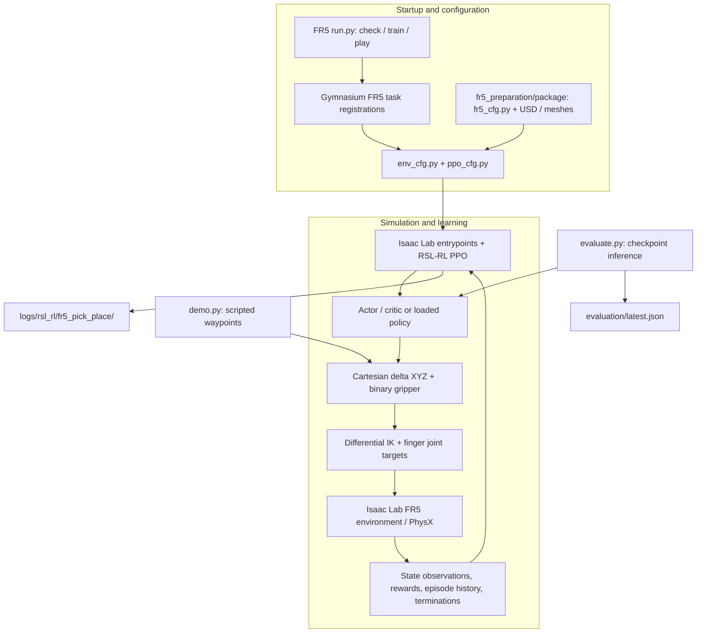

# FR5 Pick and Place with Isaac Lab

<div align="center">


**Train and evaluate a FAIRINO FR5 arm to pick, lift, transfer, and release a cube in simulation.**

[Quick start](#quick-start) · [Architecture](#system-architecture) · [Training guide](fr5_rl_development/TRAINING.md) · [Original tutorial](https://www.youtube.com/watch?v=IGVywY_FI3c)

</div>

The repository adapts an existing custom-arm pick-and-place workflow to the
**FR5 six-axis arm and a two-finger parallel gripper**, using NVIDIA Isaac Lab,
PhysX, and PPO through RSL-RL. **The maintainer's main contribution is the FR5
integration:** prepared robot assets, Cartesian end-effector control, an FR5 task,
and validation utilities. The earlier custom-arm baseline remains available.

> **Status:** simulation and training utilities are implemented. No trained FR5
> checkpoint is included. Scripted demonstrations and short training checks are
> documented separately from learned-policy results. Dynamics are simulation
> estimates; real-robot deployment has not been validated.

---

## Contents

- [Overview and features](#overview-and-features)
- [System architecture](#system-architecture)
- [Requirements](#requirements)
- [Installation](#installation)
- [Quick start](#quick-start)
- [Training, playback, and evaluation](#training-playback-and-evaluation)
- [Configuration and CLI reference](#configuration-and-cli-reference)
- [Task specification](#task-specification)
- [Repository structure](#repository-structure)
- [Validation](#validation)
- [Original custom-arm baseline](#original-custom-arm-baseline)
- [Troubleshooting](#troubleshooting)
- [Publishing and contributing](#publishing-and-contributing)
- [Acknowledgements](#acknowledgements)
- [License](#license)

## Overview and features

- **FR5 integration:** six arm joints (`j1`–`j6`) and two independently simulated
  sliding fingers (`fj1`, `fj2`), with a prepared USD physics override.
- **Asset preparation:** relative dependencies, mesh-based inertia estimates,
  revised mass parameters, portable materials, and gripper collision setup.
- **Cartesian control:** three incremental TCP position actions with differential
  inverse kinematics and a binary open/close action; fixed downward orientation.
- **FR5 pick-and-place task:** randomized cube and target positions, staged rewards,
  episode history, and success conditions requiring lifting, release, and withdrawal.
- **PPO workflow:** configuration checks, training, checkpoint playback, bounded
  playback, and episode-based evaluation.
- **Diagnostics:** static asset checks, finger motion/contact checks, a physical
  waypoint demonstration, and task-logic tests.

The FR5 work builds on upstream assets and Isaac Lab; it does not claim authorship
of the original robot meshes, simulator, framework, or tutorial.

## System architecture



`run.py` resolves the prepared asset package and registers the FR5 tasks before
calling the installed Isaac Lab backend. During simulation, the policy commands
TCP position increments and finger opening/closing; differential IK converts the
Cartesian target to arm joint targets. Observations and reward/termination logic
use simulator state. `demo.py` supplies scripted actions, while `evaluate.py`
loads a learned checkpoint and counts completed episode outcomes.

The root `run.py` launches the earlier custom arm. Use
`fr5_rl_development/run.py` for all FR5 training and playback.

## Requirements

The following versions were inspected in the development environment. They are
an environment reference, not a portable dependency lockfile.

| Component | Development environment |
| --- | --- |
| Operating system | Windows; commands below use PowerShell |
| Python | 3.12.15 |
| Isaac Lab checkout `VERSION` | 3.0.0 |
| Installed `isaaclab` distribution metadata | 27.2.0 |
| Isaac Sim | 6.2.0.0 |
| RSL-RL (`rsl-rl-lib`) | 5.5.1 |
| PyTorch | 2.11.0+cu130 |
| Gymnasium | 1.3.0 |
| Warp | 1.17.0 |
| Physics | PhysX |

Use an NVIDIA GPU and driver supported by your Isaac Sim release. GPU memory needs
depend on the number of environments; start with eight environments before scaling.
The launchers use `isaaclab_rl.entrypoints` and `isaaclab_physx` from the installed
checkout. Compatibility with Isaac Lab 2.x or other 3.x checkouts is not established.
Linux has not been verified for this repository.

## Installation

### 1. Set up Isaac Lab and its matching Isaac Sim runtime

Install a compatible Isaac Lab / Isaac Sim environment using the
[official Isaac Lab installation documentation](https://isaac-sim.github.io/IsaacLab/main/source/setup/installation/index.html).
Select the instructions matching your release; the version table above describes
this project's local environment and does not mean that the latest default branch
will expose the same APIs.

The environment must include Isaac Lab, Isaac Sim, its PhysX backend, the Isaac Lab
RL/task packages, RSL-RL, Torch, Warp, Gymnasium, and NumPy. Asset rebuilding also
uses `trimesh` and the runtime's `pxr` USD bindings. A generic `pip install isaaclab`
or an arbitrary Torch installation is not a substitute for that environment.

This task runs outside the Isaac Lab source tree. No project installation,
replacement of framework files, or additional virtual environment is required.

### 2. Obtain this repository and its large assets

Install [Git LFS](https://git-lfs.com/) before cloning. Use your fork URL if needed:

```powershell
git lfs install
git clone https://github.com/danhyoyo/isaaclab-fr5-pick-place-rl.git pick_and_place
Set-Location .\pick_and_place
git lfs pull
```

Keep all mesh files, textures, USD configuration layers, and override layers.
An LFS pointer without its downloaded object cannot be opened as a robot asset.

### 3. Select the Isaac Lab Python interpreter

Run the following from the repository root. Adjust the interpreter location:

```powershell
$IsaacPython = "D:\IsaacLab\.venv\Scripts\python.exe"
& $IsaacPython -c "import torch, warp, gymnasium, isaaclab, isaaclab_physx, isaaclab_rl; print('Runtime imports OK')"
& $IsaacPython .\fr5_rl_development\run.py check
```

The FR5 launcher locates `fr5_preparation/package/` relative to the repository,
so no asset copy or machine-specific `PYTHONPATH` is needed. The configuration check
validates both FR5 task registrations and the main robot asset path without
starting a simulation. Run the static asset check below to validate dependencies.

If you already manage Isaac Lab with `uv`, the equivalent invocation is:

```powershell
uv run --project D:\IsaacLab --no-sync python .\fr5_rl_development\run.py check
```

`--no-sync` reuses the installed environment. It does not install missing packages.

**Expected first result:** the configuration check prints an `OK:` line for both
`Isaac-FR5-PickPlace-v0` and `Isaac-FR5-PickPlace-Play-v0`, including the resolved
robot asset path. This confirms configuration loading; it does not exercise GPU
simulation or establish grasp success.

## Quick start

All commands below assume the repository root and `$IsaacPython` defined above.

```powershell
# Verify the composed asset and robot parameters
& $IsaacPython .\fr5_preparation\package\validate_asset.py

# Run a scripted, contact-based demonstration in a simulation window
& $IsaacPython .\fr5_rl_development\demo.py --viz kit --num_envs 1

# Exercise the training pipeline with a small headless run
& $IsaacPython .\fr5_rl_development\run.py train --num_envs 8 --max_iterations 2 --headless --run_name smoke

# Play the latest checkpoint generated by this FR5 experiment
& $IsaacPython .\fr5_rl_development\run.py play --num_envs 4 --checkpoint latest
```

The demo controls the same four actions as the RL policy and moves the cube through
physical contact after the initial reset. It is a scripted controller, not a learned
policy. The short training command checks the pipeline and is insufficient to learn
the task. Close the viewer or press Ctrl+C to stop interactive playback.

**Expected behavior:** the demo runs the approach → grasp → lift → transfer →
release → withdrawal sequence and exits after its finite check. The training
smoke run produces a new log directory and model checkpoints. Playback opens the
viewer using the generated model; it does not imply the smoke policy has learned
the task. Generated paths are listed in [Repository structure](#repository-structure).

## Training, playback, and evaluation

### Start a new training run

```powershell
& $IsaacPython .\fr5_rl_development\run.py train --num_envs 128 --max_iterations 5000 --headless --run_name fr5_cube30
```

Increase `--num_envs` after checking VRAM and throughput. Use `--viz kit` instead
of `--headless` to train with a viewer; do not supply both flags.

### Play or resume a specific checkpoint

After training, select the most recently written local model file and use its
absolute path. Set `$Checkpoint` to a different existing model to compare runs:

```powershell
$LatestModel = Get-ChildItem .\fr5_rl_development\logs\rsl_rl\fr5_pick_place -Recurse -Filter "model_*.pt" |
    Sort-Object LastWriteTime -Descending | Select-Object -First 1
if (-not $LatestModel) { throw "No FR5 checkpoint found. Run training first." }
$Checkpoint = $LatestModel.FullName
& $IsaacPython .\fr5_rl_development\run.py play --num_envs 4 --checkpoint $Checkpoint
& $IsaacPython .\fr5_rl_development\run.py play --num_envs 4 --checkpoint $Checkpoint --steps 650 --headless
& $IsaacPython .\fr5_rl_development\run.py train --num_envs 128 --max_iterations 2000 --headless --checkpoint $Checkpoint
```

Use absolute checkpoint paths, as in the example above. The launcher changes its
working directory to `fr5_rl_development/` to keep outputs together. On resume,
iteration accounting follows the installed RSL-RL backend; inspect the run log.
Earlier custom-arm checkpoints are incompatible with the FR5 task.

### Evaluate completed episodes

```powershell
& $IsaacPython .\fr5_rl_development\evaluate.py --checkpoint $Checkpoint --episodes 32 --num_envs 8 --seed 123 --viz none
```

The report in `fr5_rl_development/evaluation/latest.json` records successes,
success rate, drops, timeouts, the seed, and the checkpoint path. Evaluate multiple
seeds after sufficient training. Reward growth alone does not establish success.
To inspect training metrics with TensorBoard, if available in the environment:

```powershell
& $IsaacPython -m tensorboard.main --logdir .\fr5_rl_development\logs\rsl_rl\fr5_pick_place
```

See [the training guide](fr5_rl_development/TRAINING.md) for task details and checks.

## Configuration and CLI reference

### Entry points and CLI

Run commands from the repository root with the configured Isaac Lab interpreter.
The FR5 launcher forwards backend options to the installed Isaac Lab entrypoints.
Defaults below come from this repository's launcher and task configuration.

| Entry point / option | Default | Meaning and constraints |
| --- | --- | --- |
| `run.py check` | Both FR5 task registrations | Configuration and main asset-path check; does not launch simulation; accepts no extra options. |
| `run.py train --num_envs` | `128` | Parallel environments in the training scene. Start smaller for a pipeline check. |
| `run.py play --num_envs` | `4` | Parallel environments in the playback scene. |
| `--max_iterations` | `5000` in PPO configuration | Training update count passed to the backend; inspect iteration logs when resuming. |
| `--headless` | Off | Selects `--viz none`; cannot be combined with `--viz` / `--visualizer`. |
| `--viz` | `kit` for FR5 train/play | Use `kit` for a viewer or `none` without one. |
| `--checkpoint` | No bundled checkpoint | `latest` is resolved by the play launcher; an absolute model path selects a specific model. |
| `--steps` | Unbounded interactive playback | Positive integer; valid only for `play`. |
| PPO `seed` | `42` | Default in `ppo_cfg.py`. |
| `evaluate.py --checkpoint` | Required | Existing learned FR5 checkpoint path; use an absolute path. |
| `evaluate.py --episodes` | `32` | Positive completed-episode count. |
| `evaluate.py --num_envs` | `8` | Positive parallel-environment count for evaluation. |
| `evaluate.py --seed` | `123` | Evaluation seed; use multiple seeds for policy assessment. |

### Configuration files

| File | What to change |
| --- | --- |
| [constants.py](fr5_rl_development/fr5_pick_place/constants.py) | Cube dimensions/mass, workspace, pick/goal regions, TCP offset, home pose, action step, lift/hold thresholds. |
| [env_cfg.py](fr5_rl_development/fr5_pick_place/env_cfg.py) | Scene, rewards, resets, observations, terminations, timestep, environment count, task-specific drive overrides. |
| [ppo_cfg.py](fr5_rl_development/fr5_pick_place/ppo_cfg.py) | Actor/critic MLPs, rollout length, learning rate, seed, save interval, and experiment name. |
| [fr5_cfg.py](fr5_preparation/package/fr5_cfg.py) | Robot USD path, base articulation, finger targets, and actuator properties. |
| [parameters.json](fr5_preparation/package/parameters.json) | Prepared asset parameter estimates and their derivation. |

PPO uses 32 rollout steps per environment, a `3e-4` learning rate, a 100-iteration
save interval, and actor/critic MLPs of 256–128–64 with observation normalization.
Keep trained checkpoints paired with the task's observation/action configuration.

## Task specification

| Property | FR5 task |
| --- | --- |
| Training task ID | `Isaac-FR5-PickPlace-v0` |
| Playback task ID | `Isaac-FR5-PickPlace-Play-v0` |
| Object | 30 mm cube, 30 g |
| Table surface / robot base height | 0.10 m |
| Pick / target region centers | Approximately x = -0.45 m, y = -0.12 / +0.12 m |
| Reset randomization | x ±0.04 m and y ±0.02 m within the separate regions |
| Actions | TCP delta x/y/z (up to 6 mm per step), binary gripper |
| Gripper | Both fingers: open 0 m; close 0.04 m |
| End-effector orientation | Downward, fixed yaw of 90 degrees |
| Control / physics frequency | 50 Hz / 200 Hz |
| Maximum episode duration | 12 seconds |
| Policy input | Simulation state; no camera observations |
| PPO network | Actor and critic MLPs: 256–128–64 |

Success requires the cube to have been lifted at least 45 mm above its resting
height while near the closed gripper, then placed within 20 mm in XY and 8 mm in
height of the target. Cube speed must be below 0.06 m/s, both fingers must be open
below 4 mm, and the TCP must withdraw more than 55 mm. Placement conditions must
hold for 0.30 seconds. Pushing a cube directly to the target does not count.
Coordinates are local to each replicated environment; code quaternions use
`(x, y, z, w)` in this checkout.

## Repository structure

```text
pick_and_place/
├── README.md
├── THIRD_PARTY_NOTICES.md        # Upstream authors, sources, and licensing scope
├── CONTRIBUTING.md
├── .gitignore                   # Excludes logs, checkpoints, caches, local settings
├── .gitattributes               # Git LFS rules for USD and mesh assets
├── licenses/                    # Preserved upstream license texts
├── docs/archive/                # Previous Vietnamese documentation, unchanged
├── fr5_rl_development/          # Main FR5 reinforcement-learning workflow
│   ├── run.py                   # check / train / play; resolves prepared assets
│   ├── demo.py                  # Scripted physical pick/place demonstration
│   ├── evaluate.py              # Evaluate a learned policy over complete episodes
│   ├── TRAINING.md              # Detailed FR5 training guide
│   ├── fr5_pick_place/
│   │   ├── __init__.py          # Gymnasium task registrations
│   │   ├── constants.py         # Geometry, workspace, poses, success thresholds
│   │   ├── env_cfg.py           # Scene, observations, rewards, resets, terminations
│   │   ├── actions_cfg.py
│   │   ├── actions.py           # Cartesian target integration and differential IK
│   │   ├── mdp.py               # Tensor-based task observations and rewards
│   │   ├── task_logic.py        # Episode history and placement conditions
│   │   └── ppo_cfg.py           # PPO actor/critic and runner settings
│   └── tests/                  # Logic tests and simulation diagnostics
├── fr5_preparation/
│   ├── build_fr5.py             # Historical preparation utility
│   └── package/
│       ├── README.md           # Asset parameters and validation guide
│       ├── fr5_cfg.py          # Shared FR5 articulation configuration
│       ├── fr5_description/    # URDF, USD layers, and meshes; keep together
│       ├── parameters.json     # Mass/inertia estimation records
│       ├── source_manifest.json # SHA-256 hashes of original source inputs
│       ├── validate_asset.py
│       ├── gripper_scene.py
│       ├── check_contact.py
│       ├── tools/build_fr5.py
│       └── verification/       # Retained asset verification records
├── run.py                      # Earlier custom-arm launcher, not the FR5 launcher
├── lift_place_env_cfg.py        # Earlier custom-arm scene/task
├── custom_arm/                 # Earlier robot assets and agent configurations
├── cumotion_arm_description/    # Original custom-arm ROS description
├── cube_5cm/                    # Cube asset for the earlier baseline
├── mdp/                        # Earlier custom-arm task functions
├── check_gripper.py
├── gripper_scene.py
├── tests/                      # Earlier gripper/playback checks
└── how_to_run.txt               # Short command reference
```

Generated FR5 runs are saved under `fr5_rl_development/logs/rsl_rl/fr5_pick_place/`;
evaluation JSON goes to `fr5_rl_development/evaluation/`. Both are ignored by Git.
The FR5 cube is generated in code and does not use the baseline's `cube_5cm` asset.

## Validation

Configuration loading for both FR5 tasks and both baseline tasks, all three FR5
logic tests, and static FR5 asset validation passed during repository preparation
on **21 October 2026**. Static validation found no unresolved asset dependencies.
These results cover configuration and logic; they do not measure learned-policy
performance.

Run these checks with the same interpreter:

```powershell
& $IsaacPython -m unittest discover -s .\fr5_rl_development\tests -p "test_*.py"
& $IsaacPython .\fr5_rl_development\tests\smoke_env.py --viz none
& $IsaacPython .\fr5_rl_development\demo.py --viz none --num_envs 4 --seed 42
& $IsaacPython .\fr5_preparation\package\gripper_scene.py --viz none --cycles 2
& $IsaacPython .\fr5_preparation\package\gripper_scene.py --viz none --cycles 2 --gravity
& $IsaacPython .\fr5_preparation\package\check_contact.py --viz none
```

Retained asset records are in `fr5_preparation/package/verification/`. Simulation
checks generate additional records under their respective project directories.

Earlier local documentation dated 21 October 2026 reports three passing logic
tests, a 4/4 scripted demonstration, a 650-step environment check, and a two-update
PPO smoke run. The smoke policy achieved **0/2 successful evaluation episodes**.
Those training records came from the earlier standalone development layout and
are not all included here; see [the archived report](docs/archive/TRAINING.original.vi.md).
Treat these as historical results rather than evidence of a fresh-clone benchmark.

The asset has estimated mass/inertia and drive settings, and self-collision is
disabled. Neither real-robot calibration nor sim-to-real deployment is established.

## Original custom-arm baseline

The root launcher still runs the earlier custom arm:

```powershell
& $IsaacPython .\run.py check
& $IsaacPython .\run.py train --num_envs 8 --max_iterations 2 --headless
& $IsaacPython .\gripper_scene.py --viz kit --cycles 2
& $IsaacPython .\check_gripper.py --viz none
```

Its task is `Isaac-Lift-Cube-Place-Custom-Arm-v0`; logs use
`logs/rsl_rl/franka_lift_place_custom_arm/`. This historical experiment name does
not refer to the FR5. Playback requires a separately obtained compatible checkpoint.
`tests/smoke_play.py` expects a historical checkpoint under the root `logs/` folder;
it cannot run from a clean clone without that file.

The baseline gripper uses `cumotion_arm_gripper_fixed.usda` with limits [-60, 0]
degrees: -60 closes and 0 opens. Earlier checkpoints predate a gripper direction
fix and do not establish successful grasping. See the unchanged
[original README](docs/archive/README.original.vi.md) for the diagnosis and earlier
validation history; its machine-specific paths and checkpoint references are historical.

## Troubleshooting

| Symptom | What to check |
| --- | --- |
| `No module named isaaclab` or `isaaclab_physx` | Use the configured Isaac Lab interpreter and a compatible checkout. |
| `No module named fr5_cfg` | Use the FR5 launcher in this repository and keep `fr5_preparation/package/` beside `fr5_rl_development/`. |
| Asset does not open or dependencies are missing | Run `git lfs pull`; retain USD layers, meshes, and textures together; run `validate_asset.py`. |
| `--checkpoint latest` finds nothing | Train first; checkpoints and local logs are excluded from Git. |
| Playback fails to load a model | Use an FR5 checkpoint with the matching observation/action configuration. |
| GPU memory exhaustion | Reduce `--num_envs` and close other GPU workloads. |
| First launch takes a long time | Initial runtime setup may load extensions/assets and compile GPU kernels. |
| Cache/config write errors | Run from a normal PowerShell session with writable simulator cache/config directories. |
| Older tutorial commands fail | This launcher uses the installed entrypoint API; use the commands above instead of copying old Isaac Lab script paths. |

## Publishing and contributing

See [CONTRIBUTING.md](CONTRIBUTING.md) for contribution checks and Git LFS
handling. Source, robot assets, provenance records, and documentation belong in
Git; logs, checkpoints, exported policies, and local environment settings are
excluded by [.gitignore](.gitignore). Large USD and mesh files use the LFS rules in
[.gitattributes](.gitattributes).

## Acknowledgements

- **Wang Ziyuan / WangZY233** — original FR5 robot-description source:
  [FR5_Reinforcement-learning](https://github.com/WangZY233/FR5_Reinforcement-learning).
- **Robot Mania** — named maintainer of the retained custom-arm description.
  Original pick-and-place tutorial, identified by the repository maintainer:
  [YouTube tutorial](https://www.youtube.com/watch?v=IGVywY_FI3c).
- **The Isaac Lab Project Developers** — [Isaac Lab](https://github.com/isaac-sim/IsaacLab)
  and existing task foundations; original source headers are preserved.
- **FAIRINO / FAIR-INNOVATION** — nominal arm mass reference from the
  [official FR5 V6 URDF](https://github.com/FAIR-INNOVATION/frcobot_ros2/blob/main/fairino_description/urdf/fairino5_v6.urdf).

Full source and modification notes are in [THIRD_PARTY_NOTICES.md](THIRD_PARTY_NOTICES.md).

## License

This repository contains material from multiple sources. Applicable upstream
licenses and notices are preserved in [licenses/](licenses/) and existing file
headers. No blanket license has been assigned to the entire repository or to new
maintainer contributions. See [licensing scope](THIRD_PARTY_NOTICES.md#licensing-scope)
for the remaining provenance and licensing details.
