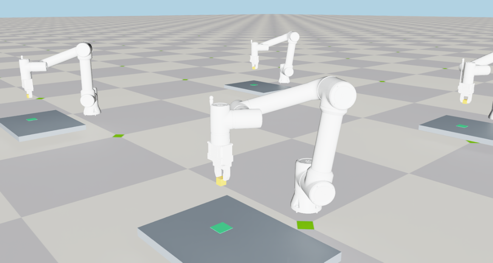
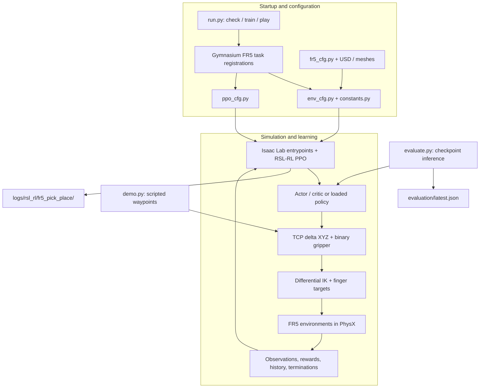

# FR5 Pick and Place with Isaac Lab

<div align="center">


**Train and evaluate a FAIRINO FR5 arm to pick, lift, transfer, and release a cube in simulation.**



*Parallel FR5 pick-and-place environments running in Isaac Lab.*

[Quick start](#quick-start) · [Architecture](#system-architecture) · [Training guide](TRAINING.md)

</div>

This standalone project integrates a **FAIRINO FR5 six-axis arm and two-finger
parallel gripper** with NVIDIA Isaac Lab, PhysX, and PPO through RSL-RL. It
includes prepared robot assets, Cartesian end-effector control, an FR5-specific
pick-and-place task, scripted validation, training, playback, and evaluation.

> **Status:** the simulation, task, and training pipeline are implemented. No
> converged FR5 checkpoint is included. The retained two-iteration PPO smoke
> checkpoint achieved 0/2 successful evaluation episodes and is only evidence
> that the pipeline runs. Dynamics are simulation estimates; real-robot
> deployment has not been validated.

---

## Contents

- [Overview and features](#overview-and-features)
- [System architecture](#system-architecture)
- [Requirements](#requirements)
- [Installation](#installation)
- [Quick start](#quick-start)
- [Training, playback, and evaluation](#training-playback-and-evaluation)
- [Configuration and CLI reference](#configuration-and-cli-reference)
- [Task specification](#task-specification)
- [Repository structure](#repository-structure)
- [Validation](#validation)
- [Asset preparation and limitations](#asset-preparation-and-limitations)
- [Troubleshooting](#troubleshooting)
- [Acknowledgements](#acknowledgements)
- [License](#license)

## Overview and features

- **Standalone FR5 integration:** six arm joints (`j1`–`j6`) and two simulated
  sliding fingers (`fj1`, `fj2`), with a prepared USD physics override and no
  dependency on another pick-and-place project.
- **Cartesian control:** three incremental TCP position actions use differential
  inverse kinematics; a fourth binary action opens or closes both fingers while
  the end-effector maintains a fixed downward orientation.
- **Pick-and-place task:** the 30 mm cube and target are randomized in separate
  regions, with staged rewards and success conditions that require lifting,
  placement, release, and withdrawal.
- **PPO workflow:** configuration checks, headless or visual training, checkpoint
  playback, bounded playback, resume support, and episode-based evaluation.
- **Physical scripted demonstration:** `demo.py` drives the same four actions as
  the policy through approach, grasp, lift, transfer, release, and withdrawal;
  the object is not attached or teleported during the sequence.
- **Validation utilities:** static asset validation, gripper motion/contact
  checks, task-logic regression tests, and a full-environment smoke test.

The project uses simulator state observations rather than cameras. It does not
cover arbitrary object orientation, perception, real-robot control, or sim-to-real
transfer.

## System architecture



`run.py` registers the two FR5 Gymnasium tasks before calling the installed
Isaac Lab training or playback entrypoint. The policy commands TCP displacement
and gripper state; differential IK converts the Cartesian target into arm joint
targets. Task observations, rewards, history, and termination conditions are
computed from simulator state.

## Requirements

| Component | Requirement | Notes |
| --- | --- | --- |
| Operating system | Windows | Commands below use PowerShell. |
| Isaac Lab / Isaac Sim | Existing compatible installation | This checkout was developed against the environment at `D:\IsaacLab`; no portable lockfile is included. |
| RL stack | RSL-RL integration supplied with Isaac Lab | The launcher imports `isaaclab_rl` and selects `rsl_rl`. |
| Physics | PhysX backend supplied with Isaac Lab | The environment imports `isaaclab_physx`. |
| GPU | NVIDIA GPU supported by the selected Isaac Sim release | Start with eight environments and increase only after checking VRAM use. |
| Python packages | Torch, Warp, Gymnasium, NumPy, Isaac Lab packages | Use the Python interpreter belonging to the Isaac Lab environment. |

Asset rebuilding additionally uses `trimesh` and the runtime's `pxr` USD
bindings. A generic Python environment is not a substitute for the matching
Isaac Lab and Isaac Sim runtime.

## Installation

### 1. Prepare Isaac Lab

Install Isaac Lab and its matching Isaac Sim runtime by following the
[official installation guide](https://isaac-sim.github.io/IsaacLab/main/source/setup/installation/index.html).
This repository runs outside the Isaac Lab source tree and does not require
modifying framework files.

### 2. Keep the project assets together

The robot's USD layers reference files under `fr5_description/`. Keep the full
directory when copying or cloning the project. The main composed asset is:

```text
fr5_description/urdf/fr5_withgripper/fr5_arm.usda
```

### 3. Select the Isaac Lab interpreter

From the repository root, adjust the interpreter path if your Isaac Lab checkout
is installed elsewhere:

```powershell
Set-Location D:\IsaacProjects\fr5_arm
$IsaacPython = "D:\IsaacLab\.venv\Scripts\python.exe"
& $IsaacPython -c "import torch, warp, gymnasium, isaaclab, isaaclab_physx, isaaclab_rl; print('Runtime imports OK')"
& $IsaacPython .\run.py check
```

If the environment is managed with `uv`, the equivalent configuration check is:

```powershell
uv run --project D:\IsaacLab --no-sync python .\run.py check
```

`--no-sync` reuses the installed environment; it does not install missing
packages.

**Expected first result:** `run.py check` prints an `OK:` line for both
`Isaac-FR5-PickPlace-v0` and `Isaac-FR5-PickPlace-Play-v0`, including the cube
size, action policy, and resolved robot asset. This verifies configuration
loading, not GPU simulation or grasp success.

## Quick start

All commands below assume the repository root and `$IsaacPython` defined above.

```powershell
# Validate the composed asset and parameter records
& $IsaacPython .\validate_asset.py

# Run one scripted contact-based demonstration in a viewer
& $IsaacPython .\demo.py --viz kit --num_envs 1

# Exercise the complete training pipeline with a short headless run
& $IsaacPython .\run.py train --num_envs 8 --max_iterations 2 --headless --run_name smoke

# Play the latest checkpoint from this FR5 experiment
& $IsaacPython .\run.py play --num_envs 4 --checkpoint latest
```

The scripted demo is a deterministic controller, not a learned policy. The
two-iteration training command checks the training pipeline but is insufficient
to learn the task. Close the viewer or press `Ctrl+C` to stop interactive
playback.

## Training, playback, and evaluation

### Start a training run

```powershell
& $IsaacPython .\run.py train --num_envs 128 --max_iterations 5000 --headless --run_name fr5_cube30
```

Increase `--num_envs` only after checking VRAM use and throughput. Omit
`--headless` to use the default Kit viewer, or explicitly pass `--viz kit`.
Do not combine `--headless` with `--viz` or `--visualizer`.

### Play or resume a checkpoint

Play the newest FR5 checkpoint:

```powershell
& $IsaacPython .\run.py play --num_envs 4 --checkpoint latest
```

To select a specific model, resolve its absolute path first:

```powershell
$LatestModel = Get-ChildItem .\logs\rsl_rl\fr5_pick_place -Recurse -Filter "model_*.pt" |
    Sort-Object LastWriteTime -Descending | Select-Object -First 1
if (-not $LatestModel) { throw "No FR5 checkpoint found. Run training first." }
$Checkpoint = $LatestModel.FullName

& $IsaacPython .\run.py play --num_envs 4 --checkpoint $Checkpoint
& $IsaacPython .\run.py play --num_envs 4 --checkpoint $Checkpoint --steps 650 --headless
& $IsaacPython .\run.py train --num_envs 128 --max_iterations 2000 --headless --checkpoint $Checkpoint
```

Resume iteration accounting follows the installed RSL-RL backend; inspect the
training log to determine actual progress. Checkpoints produced by a different
robot or observation/action configuration are not compatible.

### Evaluate completed episodes

```powershell
& $IsaacPython .\evaluate.py --checkpoint $Checkpoint --episodes 32 --num_envs 8 --seed 123 --viz none
```

The report at `evaluation/latest.json` records successes, success rate, drops,
timeouts, seed, and checkpoint path. Evaluate multiple seeds after sufficient
training. Reward growth alone does not establish task success.

If TensorBoard is available in the environment:

```powershell
& $IsaacPython -m tensorboard.main --logdir .\logs\rsl_rl\fr5_pick_place
```

See [TRAINING.md](TRAINING.md) for the detailed task and training notes.

## Configuration and CLI reference

### Entry points and options

| Entry point / option | Default | Meaning and constraints |
| --- | --- | --- |
| `run.py check` | Both FR5 task registrations | Validates configuration and the main asset path without launching simulation; accepts no additional options. |
| `run.py train --num_envs` | `128` from the scene configuration | Number of parallel training environments. Start smaller for a smoke test. |
| `run.py play --num_envs` | `4` from the play configuration | Number of parallel playback environments. |
| `--max_iterations` | `5000` in `ppo_cfg.py` | PPO update count passed to the training backend. |
| `--headless` | Off | Selects `--viz none`; cannot be combined with an explicit visualizer option. |
| `--viz` | `kit` for train/play | Use `kit` for a viewer or `none` without one. |
| `--checkpoint` | No bundled converged checkpoint | `latest` resolves the newest FR5 model; an absolute path selects a specific model. |
| `--steps` | Unbounded playback | Positive integer available only in `play` mode. |
| PPO `seed` | `42` | Training seed configured in `ppo_cfg.py`. |
| `evaluate.py --checkpoint` | Required | Path to an existing FR5 checkpoint. |
| `evaluate.py --episodes` | `32` | Number of completed episodes to evaluate. |
| `evaluate.py --num_envs` | `8` | Parallel environments used during evaluation. |
| `evaluate.py --seed` | `123` | Evaluation seed. |

### Configuration files

| File | Purpose |
| --- | --- |
| [`fr5_pick_place/constants.py`](fr5_pick_place/constants.py) | Cube properties, workspace, regions, TCP offset, home pose, action step, and lift/hold thresholds. |
| [`fr5_pick_place/env_cfg.py`](fr5_pick_place/env_cfg.py) | Scene, actions, observations, rewards, resets, terminations, timestep, and environment count. |
| [`fr5_pick_place/ppo_cfg.py`](fr5_pick_place/ppo_cfg.py) | Actor/critic networks, rollout length, learning rate, seed, save interval, and experiment name. |
| [`fr5_cfg.py`](fr5_cfg.py) | Robot USD path, articulation setup, finger targets, and actuator properties. |
| [`parameters.json`](parameters.json) | Prepared asset parameters and estimation method. |

PPO uses 32 rollout steps per environment, a `3e-4` learning rate, a
100-iteration save interval, and actor/critic MLPs with hidden layers
256–128–64 and observation normalization.

## Task specification

| Property | FR5 task |
| --- | --- |
| Training task ID | `Isaac-FR5-PickPlace-v0` |
| Playback task ID | `Isaac-FR5-PickPlace-Play-v0` |
| Object | 30 mm cube, 30 g |
| Table surface / robot base height | 0.10 m / 0.10 m |
| Pick / target centers | Approximately x = -0.45 m, y = -0.12 m / +0.12 m |
| Reset randomization | x ±0.04 m and y ±0.02 m in separate regions |
| Actions | TCP delta x/y/z up to 6 mm per control step, plus binary gripper |
| Gripper targets | Both fingers: open = 0 m; closed = 0.04 m |
| End-effector orientation | Fixed downward orientation with 90° yaw |
| Control / physics frequency | 50 Hz / 200 Hz |
| Maximum episode duration | 12 seconds |
| Policy input | Simulation state; no camera observations |
| PPO network | Actor and critic MLPs: 256–128–64 |

Success requires the cube to have been lifted at least 45 mm above its resting
height while near the closed gripper, then placed within 20 mm in XY and 8 mm in
height of the target. Cube speed must be below 0.06 m/s, both fingers must be open
below 4 mm, and the TCP must withdraw more than 55 mm. Placement conditions must
hold continuously for 0.30 seconds. Pushing the cube across the table does not
count as success. Coordinates are local to each replicated environment; code
quaternions use `(x, y, z, w)`.

## Repository structure

```text
fr5_arm/
├── README.md
├── TRAINING.md                  # Detailed training and evaluation guide
├── run.py                       # check / train / play launcher
├── demo.py                      # Scripted physical pick-and-place validation
├── evaluate.py                  # Learned-policy episode evaluation
├── fr5_cfg.py                   # FR5 articulation configuration
├── parameters.json              # Asset parameter estimates and provenance
├── source_manifest.json         # SHA-256 hashes of source asset files
├── validate_asset.py            # Static asset and dependency validation
├── gripper_scene.py             # Standalone gripper motion check
├── check_contact.py             # Gripper contact check
├── docs/images/                 # README media
├── fr5_description/             # URDF, composed USD layers, and meshes
├── fr5_pick_place/
│   ├── __init__.py              # Gymnasium task registrations
│   ├── constants.py             # Geometry, workspace, poses, and thresholds
│   ├── env_cfg.py               # Scene, MDP terms, timing, and task setup
│   ├── actions_cfg.py           # Cartesian action configuration
│   ├── actions.py               # Cartesian target integration and IK
│   ├── mdp.py                   # Tensor-based task observations and rewards
│   ├── task_logic.py            # Episode history and placement conditions
│   └── ppo_cfg.py               # PPO runner, networks, and algorithm settings
├── tests/
│   ├── test_task_logic.py       # Reward/success and partial-reset regressions
│   └── smoke_env.py             # Full environment timeout/reset smoke test
├── verification/                # Retained asset, demo, and pipeline records
├── logs/                        # Generated training logs/checkpoints; ignored
└── evaluation/                  # Generated policy evaluation reports; ignored
```

## Validation

The retained records report the following checks from **21 October 2026**:

- Both train and play configurations loaded successfully.
- Six task-logic regression tests are currently present; the retained summary
  records three passing tests from the validation run made at that time.
- The scripted seed-42 demonstration completed physical pick-and-place in 4/4
  environments without attaching or teleporting the cube during the sequence.
- The full environment ran for 650 steps across four environments with finite
  observations and rewards, a 47-element observation, and four actions.
- A two-update PPO smoke run produced `model_0.pt` and `model_1.pt`; bounded
  playback loaded the latest checkpoint and ran for 650 steps.
- The smoke checkpoint evaluation completed 2 episodes with 0 successes and
  2 timeouts. It is not a trained solution.

Run the available checks with the same Isaac Lab interpreter:

```powershell
& $IsaacPython -m unittest discover -s .\tests -p "test_*.py"
& $IsaacPython .\tests\smoke_env.py --viz none
& $IsaacPython .\demo.py --viz none --num_envs 4 --seed 42
& $IsaacPython .\validate_asset.py
& $IsaacPython .\gripper_scene.py --viz none --cycles 2
& $IsaacPython .\gripper_scene.py --viz none --cycles 2 --gravity
& $IsaacPython .\check_contact.py --viz none
```

Detailed retained results are under `verification/`, including
`training_checks.json`, `scripted_pick_place_seed42.json`, `environment.json`,
`static.json`, `motion.json`, `motion_gravity.json`, and `contact.json`.

## Asset preparation and limitations

The asset source was copied from
[WangZY233/FR5_Reinforcement-learning](https://github.com/WangZY233/FR5_Reinforcement-learning).
Only the `fr5_withgripper` variant and required meshes are retained.

The prepared asset includes relative mesh paths, portable preview materials,
mesh-derived center-of-mass and inertia estimates, two-finger drives, mesh-based
gripper collision, and authored Isaac Lab actuator settings. The main simulation
layer is `fr5_description/urdf/fr5_withgripper/fr5_arm.usda`; the underlying
`fr5_withgripper.usd` alone does not include every override.

Important limitations:

- Masses for the seven arm links use the nominal FR5 V6 values referenced from
  FAIRINO's official URDF, but geometry in this project differs from that model.
- Centers of mass and inertia tensors are uniform convex-hull estimates, not CAD
  or measured values. Total assigned mass is approximately 24.062 kg.
- Gripper mass, friction, drive gains, and collision decomposition are simulation
  starting points and have not been calibrated against hardware.
- Self-collision remains disabled. Collision pairs must be reviewed before it is
  enabled.
- The task uses fixed downward grasp orientation and state observations. It does
  not establish perception performance, arbitrary-object manipulation, or
  real-world safety.

## Troubleshooting

| Symptom | What to check |
| --- | --- |
| `No module named isaaclab` or `isaaclab_physx` | Run the command with the Python interpreter from the compatible Isaac Lab environment. |
| `No module named fr5_cfg` | Run from the repository root and keep `fr5_cfg.py`, `fr5_pick_place/`, and `fr5_description/` together. |
| Asset does not open or reports unresolved dependencies | Keep all USD layers and mesh directories together, then run `validate_asset.py`. |
| `--checkpoint latest` finds nothing | Run training first; generated logs and checkpoints are excluded by `.gitignore`. |
| Playback cannot load a model | Use a checkpoint trained with this FR5 task and the same observation/action configuration. |
| GPU memory exhaustion | Reduce `--num_envs` and close other GPU workloads. |
| The first simulation launch is slow | Isaac Sim may need to load extensions, build caches, and compile GPU kernels. |
| A smoke checkpoint does not pick up the cube | Expected: the two-update run validates the pipeline and is not long enough to learn the task. |

## Acknowledgements

- **Wang Ziyuan / WangZY233** — original FR5 description source:
  [FR5_Reinforcement-learning](https://github.com/WangZY233/FR5_Reinforcement-learning).
- **The Isaac Lab Project Developers** —
  [Isaac Lab](https://github.com/isaac-sim/IsaacLab), simulation framework,
  training entrypoints, and task foundations.
- **FAIRINO / FAIR-INNOVATION** — nominal link-mass reference from the
  [official FR5 V6 URDF](https://github.com/FAIR-INNOVATION/frcobot_ros2/blob/main/fairino_description/urdf/fairino5_v6.urdf).

## License

No repository-wide license file is currently present. Upstream source headers and
notices continue to apply to their respective files. Before redistribution or
public release, review the licensing terms of the retained robot descriptions,
meshes, and third-party framework components and add explicit licensing for new
project contributions.
